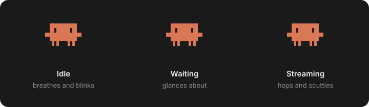

<div align="center">

# ✻ Token stats for Claude Code

**See how fast Claude is writing, how long it waits before it starts, and how much of every prompt the cache is serving: live, right above the prompt.**



<sub>Mock-ups with example data.</sub>

</div>

---

## What you get

**A strip above the prompt.** A quiet line in the band over the input box: Clawd on the left, the last turn's numbers on the right, styled like the model picker (the figure bright, its unit dim). While a reply streams it reads `· live` and the speed glides from reading to reading instead of jumping.

- **Click it** to open the panel. It steps aside while the panel is open.
- **Hover it** and a `✕` appears after the label: click that to tuck the strip away.

**A side panel** with the whole session:

<table>
<tr>
<td width="52%" valign="top">

</td>
<td valign="top">

- **Now / Last turn**: the speed in large type, with time to first token and output tokens.
- **Speed**: a sparkline of tokens per second over the last 30 turns, with the average and the peak. Hover a point to see its turn.
- **Cache**: the session's prompt tokens split into read from the cache, written to it, and neither, with a legend like the app's own Context panel.
- **Turns**: every turn, newest first, each with a bar of its speed against the session's peak. Cache hits of 90% and up show green, under 50% orange.

</td>
</tr>
</table>

**Clawd**, the Claude Code mascot, drawn pixel for pixel from the terminal banner, in the strip and the panel. He follows the turn:



## Install

At the prompt of a Claude Code terminal session:

```
/plugin install token-stats --marketplace Deeptanshuu/claude-token-stats
```

Answer `y` to add the marketplace, then pick a scope (Enter takes the user scope). The mod runs right away, no restart needed.

From a shell:

```bash
claude plugin install token-stats --marketplace Deeptanshuu/claude-token-stats
```

In the desktop app, where `/plugin` does not run: click **+** next to the prompt box, then **Plugins**, **Add marketplace** with `Deeptanshuu/claude-token-stats`, then **Add plugin**.

## Use

| Command | What it does |
| --- | --- |
| `/token-stats` | Open the panel, or close it if it's open |
| `/token-stats open` · `/token-stats close` | Just that |
| `/token-stats strip` | Show or hide the strip above the prompt |
| `/token-stats reset` | Clear the session's turns and cache totals |

The panel opens by itself when a session starts; close it and the strip (or `/token-stats`) brings it back.

## How it measures

Everything comes from the usage the API reports for each request of the main conversation. Subagents run alongside it and are left out, so they don't blur the speed.

- **tok/s** is output tokens over the time they streamed. Two cases are timed over the whole request instead, since the visible stream would overstate them: a reply with thinking (its tokens count in full but stream only as a short summary), and a short reply that arrives in one burst.
- **Live tok/s** is estimated from the text and tool input as they stream, over the last 1.5 seconds, and eased toward each new reading so it glides. Thinking summaries are left out, since their length says little about the tokens behind them, so the figure appears once the reply itself starts. When the request ends it settles on the API's real count.
- **ttft** is the time from sending a request to its first streamed piece. With hidden thinking, that includes the thinking.
- **Cache hit** is the share of prompt tokens read from the cache: `cache_read / (input + cache_read + cache_write)`.

## Requirements

Claude Code with mods (function hooks), tested on 2.1.309. Mods are early access, so the API may change between releases. Built for the desktop app; in the terminal the strip and panel draw as text, without the pixel art.

## Develop

```bash
claude plugin validate .
claude plugin test .
```

Run it from a working copy with `claude --plugin-dir .`. The hooks are in `hooks/register.tsx`; the strip's clickable text is a surface module, `hooks/band-client.tsx`, since the desktop draws a mod's buttons with chrome of its own.

## License

[MIT](LICENSE)
